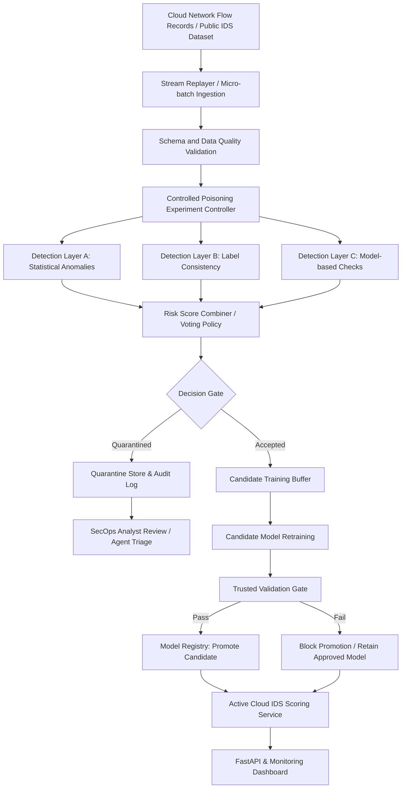

# Real-Time Detection and Mitigation of Data Poisoning Attacks on Continuously Retrained Cloud Intrusion Detection Systems

[](https://www.python.org/)
[]()
[]()

A BS Cybersecurity Final Year Design Project (FYDP) at **Dawood University of Engineering & Technology, Karachi**.

- **Faculty / Department:** Faculty of Information & Computing Sciences / Department of Cybersecurity
- **Program & Session:** BS Cybersecurity, Session 23 Fall
- **Supervisor:** Sir Arfan Naich
- **Group Members:**
  - Sofia Naseem (`23F-BSCY-40`)
  - Sobia Khan (`23F-BSCY-54`)
  - Hiba Siddiqui (`23F-BSCY-56`)

---

## 📌 Scope Clarification

> **Important:** This project focuses on **data-poisoning attacks** against the training and retraining data of a cloud-based **Intrusion Detection System (IDS)**. The IDS serves as the victim model used to evaluate the defense. Building a ransomware detector is **not** a project objective and has been completely removed per supervisor direction.

---

## 📖 Project Overview

Modern cloud intrusion detection systems periodically update and retrain their machine learning classifiers using freshly collected network telemetry and flow records. When untrusted or compromised endpoints contribute training records or labels, adversaries can inject **poisoned data** (such as label-flipping or crafted samples) to degrade detection rates, distort decision boundaries, or create targeted evasion corridors.

This system provides a real-time, multi-layered data-validation and safe-retraining pipeline that:
1. **Validates Stream Quality:** Ingests micro-batches and validates schema, missing values, duplicates, and range constraints.
2. **Executes Multi-Layer Poisoning Detection:**
   - **Layer A (Statistical Anomaly):** Isolation Forest / Local Outlier Factor (LOF) to flag feature distribution shifts.
   - **Layer B (Label Consistency):** $k$-NN neighborhood consistency to detect label-flipping and anomalous label assignments.
   - **Layer C (Model-Based Check):** Prediction loss margin and confidence disparity checks.
3. **Quarantines Suspicious Samples:** Routes suspicious records into an auditable quarantine store with forensic decision reasons rather than silently dropping them.
4. **Safeguards Model Retraining:** Trains candidate models exclusively on accepted clean data.
5. **Enforces Trusted Validation Gating & Rollback:** Evaluates candidate models against an isolated, clean holdout dataset. Models causing performance regressions are blocked from promotion, and the last known good model remains active.
6. **Provides SecOps Visibility & Agent Interoperability:** Exposes FastAPI endpoints, an interactive review dashboard, and structured audit logs for real-world SecOps workflows and autonomous agent integration.

---

## 🏗️ System Architecture



---

## 📂 Repository Structure

```text
├── README.md                           # Master project documentation
├── requirements.txt                    # Project dependencies
├── .env.example                        # Configuration template
├── .gitignore                          # Git ignore definitions
├── docker-compose.yml                  # Container orchestration
├── configs/                            # System configurations
│   ├── data.yaml                       # Dataset schema, features, splits
│   ├── stream.yaml                     # Streaming & micro-batch settings
│   ├── detectors.yaml                  # Multi-layer detection parameters
│   └── experiments.yaml                # Poisoning rate & evaluation settings
├── docs/                               # Academic deliverables & documentation
│   ├── proposal.md
│   ├── literature-review.md
│   ├── requirements.md
│   ├── architecture.md
│   ├── experiment-protocol.md
│   └── meeting-log.md
├── data/                               # Data stores (clean splits & quarantine)
│   ├── README.md
│   ├── raw/                            # Reference raw datasets
│   └── processed/                      # Train, val, and trusted holdout splits
├── src/                                # Source code
│   ├── common/                         # Shared utilities, logging, schemas
│   ├── data/                           # Data loader, validation & streaming
│   ├── attacks/                        # Controlled label-flipping & injection
│   ├── detection/                      # Multi-layer detection algorithms
│   ├── quarantine/                     # Quarantine store & audit tracking
│   ├── training/                       # Candidate trainer, validation gate, registry
│   ├── api/                            # REST API backend (FastAPI)
│   └── dashboard/                      # Web interface for SecOps monitoring
├── tests/                              # Automated test suites
│   ├── unit/                           # Unit tests for components
│   └── integration/                    # Pipeline integration tests
└── experiments/                        # Experiment runners and evaluation results
    ├── run_experiment.py
    └── results/
```

---

## ⚡ Quick Start

### 1. Install Dependencies
```bash
pip install -r requirements.txt
```

### 2. Prepare Dataset and Baseline IDS
```bash
python -m src.data.prepare
python -m src.training.train_candidate --clean-baseline
```

### 3. Run Controlled Poisoning Experiments
```bash
python -m experiments.run_experiment --attack label_flip --rate 0.10
```

### 4. Launch API and Dashboard
```bash
uvicorn src.api.app:app --host 127.0.0.1 --port 8000 --reload
```
