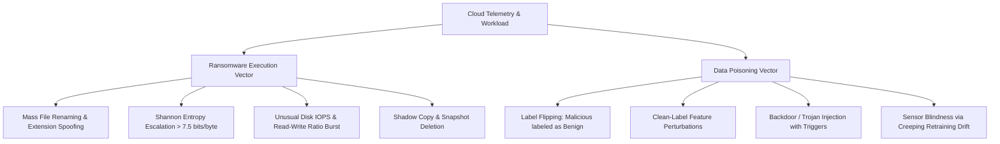

# Comprehensive Literature Review: Real-Time Ransomware and Poisoning Attack Detection in Cloud Environments Using Machine Learning

**Department of Cybersecurity**  
**Faculty of Information & Computing Sciences**  
**Dawood University of Engineering & Technology, Karachi**  
**Program:** BS Cybersecurity (Session 23 Fall)  
**Project:** Final Year Design Project (FYDP-1)  
**Project Members:** Sofia Naseem (23F-BSCY-40), Sobia Khan (23F-BSCY-54), Hiba Siddiqui (23F-BSCY-56)  
**Supervisor:** Sir Arfan Naich  

---

## 1. Introduction and Background

Over the past decade, cloud computing has transitioned from an operational alternative into the foundational backbone of global enterprise infrastructure. Organizations rely extensively on cloud service providers (CSPs) such as Amazon Web Services (AWS), Microsoft Azure, and Google Cloud Platform (GCP) for elastic compute resources, shared file systems, scalable object storage buckets, and container orchestration. However, the foundational attributes that render cloud computing uniquely scalable—shared tenancy, pervasive REST API accessibility, complex multi-tenant identity and access management (IAM), and continuous synchronization across endpoints—drastically magnify the threat landscape.

Among modern cloud cyber threats, two distinct attack vectors have emerged as extraordinarily destructive yet inadequately defended by traditional perimeter mechanisms:

1. **Cloud-Targeted Ransomware:** Malicious actors utilize automated encryption routines to compromise virtual machine (VM) filesystems, shared network volumes, and cloud object repositories (e.g., AWS S3, Azure Blob Storage). Because cloud storage frequently synchronizes local endpoint updates automatically, ransomware infection on a single compromised client or instance propagates horizontally within seconds. The consequences involve catastrophic business interruption, extortive ransom demands, and data destruction.
2. **Adversarial Training Data Poisoning:** Contemporary cloud defense architectures and Security Operations Centers (SOCs) increasingly employ Machine Learning (ML) models to automate threat detection and anomaly hunting. However, when these ML systems periodically retrain on unverified streaming event logs or crowd-sourced telemetry, attackers can inject carefully crafted, adversarial data points. Such attacks quietly alter model decision boundaries through label-flipping or clean-label backdoor injections. Consequently, the defense system learns to misclassify malicious actions as benign, effectively blinding security teams without generating runtime software crashes.

Conventional security mechanisms—primarily signature-based Antivirus (AV), Intrusion Detection Systems (IDS), and static heuristic rules—fail against both threats. Ransomware variants employ polymorphic obfuscation, unique runtime-generated encryption keys, and file-less execution that circumvent static signatures. Simultaneously, training data poisoning operates entirely within the statistical layer of machine learning, rendering rule-based monitors oblivious to subtle model corruption. 

This literature review presents a comprehensive, multi-dimensional academic synthesis of existing research across three interconnected research themes: (1) host and cloud ransomware detection architectures, (2) adversarial machine learning and data poisoning counter-measures, and (3) real-time cloud telemetry and stream processing pipelines. Finally, it identifies the foundational research gaps that motivate our proposed unified dual-engine detection architecture.

---

## 2. Taxonomy of Cloud Security Threat Vectors

### 2.1 The Ransomware Kill-Chain in Cloud Workloads
Modern cloud ransomware departs from legacy PC locker Trojans. In cloud environments, attacks typically progress through:
1. **Initial Access & Privilege Escalation:** Exploiting misconfigured API credentials, weak SSH keys, or vulnerable container images.
2. **Discovery & Lateral Movement:** Querying cloud metadata APIs (e.g., AWS IMDSv2), locating attached Elastic Block Store (EBS) volumes, shared NFS mounts, and object storage buckets.
3. **Defense Evasion & Invalidation of Recovery:** Deleting Volume Shadow Copies, disabling automatic snapshot lifecycles, and terminating cloud monitoring agents (e.g., CloudWatch or Datadog daemons).
4. **Rapid Encryption Burst:** Employing high-speed symmetric ciphers (e.g., AES-256-CBC, ChaCha20) to encrypt user data in-place, rewriting files with high information entropy and appending custom extensions.

### 2.2 The Poisoning Threat Model in Continuous ML Retraining
In modern Cloud Detection and Response (CDR) pipelines, models must continuously adapt to evolving normal cloud activity by periodically ingesting fresh event logs. Adversarial machine learning identifies two primary poisoning paradigms:
- **Availability Attacks (Indiscriminate Denial of Service):** An attacker injects corrupted samples aimed at degrading the global classification accuracy and F1-score of the classifier, causing so many false alarms that human analysts are forced to disable the system.
- **Integrity Attacks (Targeted Backdoors & Subversion):** The attacker crafts stealthy samples (often less than 5% to 10% of the training split) such that the model retains high accuracy on benign data, but fails to identify a specific ransomware family or malicious signature.

---

## 3. Theme 1: Cloud and Host Ransomware Detection Mechanisms

### 3.1 Static vs. Dynamic Behavioral Detection
Early research on ransomware detection predominantly relied on static binary inspection, extracting static features including Portable Executable (PE) headers, imported DLL functions, and hardcoded strings. However, as demonstrated by Kharaz et al. [11] in their seminal evaluation of over 148,000 malware binaries, static analysis is easily defeated by runtime packers, crypters, and code obfuscation techniques.

Consequently, research pivoted towards dynamic behavioral monitoring. Sgandurra et al. [3] introduced **EldeRan**, a framework utilizing dynamic behavioral features gathered during early execution phases. By monitoring system calls, registry modifications, file operation frequencies, and directory traversal routines, EldeRan demonstrated a 96.34% detection rate using regularized Logistic Regression. While EldeRan highlighted the supremacy of behavioral indicators over static signatures, its architecture was inherently designed for offline batch sandboxing, necessitating substantial dwell time before yielding a verdict.

### 3.2 Information Entropy and File-System Heuristics
A definitive signature of cryptographic ransomware is the dramatic alteration in file content distribution. Unencrypted plain text, source code, and structured databases exhibit moderate to low Shannon entropy (typically 2.0 to 5.5 bits per byte). In contrast, high-grade cryptographic algorithms produce ciphertexts indistinguishable from pseudo-random noise, yielding Shannon entropy approaching the theoretical maximum of 8.0 bits per byte ($E > 7.5$).

Scaife et al. [1] pioneered filesystem-level behavioral heuristics in **CryptoLock (and Drop It)**. CryptoLock monitors three primary behavioral indicators:
$$\text{Entropy}(X) = -\sum_{i=1}^{n} P(x_i) \log_2 P(x_i)$$
coupled with file-type change verification via magic byte inspection and abnormal burst rates of file modifications. Their prototype successfully halted ransomware samples after fewer than 10 files were encrypted. Similarly, Continella et al. [2] developed **ShieldFS**, integrating a custom virtual file system (VFS) driver that monitors low-level I/O request packets (IRPs), dynamically rolling back encrypted blocks using a copy-on-write cache.

*Cloud Limitation:* Although CryptoLock [1] and ShieldFS [2] achieve remarkable efficacy on traditional workstations, their approaches require low-level kernel drivers or local hypervisor filesystem hooks. In modern multi-tenant cloud environments—where storage relies heavily on distributed block devices (AWS EBS) or RESTful object stores (AWS S3, Azure Blob)—endpoint file system hooks cannot inspect aggregated multi-instance cloud transactions, nor can they scale across ephemeral container instances without prohibitive performance degradation.

### 3.3 Deep Learning and Time-Series Modeling
To accommodate temporal sequences of events, Davies et al. [6] developed **CloudRanger**, an architecture applying 1D-Convolutional Neural Networks (1D-CNN) and Long Short-Term Memory (LSTM) networks directly to storage volume disk I/O metrics within cloud hypervisors. CloudRanger demonstrated 95.8% accuracy within 45 seconds of attack initiation. Similarly, Zahoora et al. [9] applied an Autoencoder coupled with Bi-LSTMs to capture sliding time-window entropy dynamics.

*Limitations of Deep Learning Approaches:* While recurrent neural architectures excel at sequence modelling, they impose significant inference latency, often exceeding several hundred milliseconds per evaluation window. Furthermore, deep neural networks function as uninterpretable black boxes, preventing security analysts from identifying the underlying causal factors (e.g., which specific process or API key initiated the destructive encryption burst).

---

## 4. Theme 2: Adversarial Machine Learning and Poisoning Defenses

### 4.1 Vulnerabilities of Machine Learning in Cybersecurity
Machine learning algorithms fundamentally assume that training data and production runtime data are drawn from identical, independent distributions ($\mathcal{D}_{train} \equiv \mathcal{D}_{test}$). In adversarial security domains, this assumption is invalid. Biggio et al. [13] first demonstrated gradient-based training data poisoning against Support Vector Machines (SVMs), proving that an attacker inserting as few as 8% malicious samples could increase error rates from 3% to above 24%.

Jagielski et al. [14] generalized poisoning attacks against linear models and regression frameworks, proposing the **TRIM** optimization countermeasure. Shafahi et al. [15] expanded the threat scope to deep neural networks through "Poison Frogs!", establishing that clean-label attacks—wherein samples appear visually or statistically consistent with their target class but collide in hidden representation spaces—can bypass superficial label-verification filters entirely.

In the cybersecurity malware classification domain, Severi et al. [19] showed that attackers can exploit model explainability frameworks (such as SHAP values) to design highly potent backdoor triggers. By watermarking benign files with specific top-ranked features, their attack achieved a 98% backdoor success rate with negligible degradation in clean accuracy, proving that security classifiers that blindly ingest training data without rigorous defensive sanitization will inevitably be hijacked.

### 4.2 Data Sanitization and Defensive Countermeasures
To defend against training data poisoning, researchers have investigated three foundational methodologies:

1. **Spatial Outlier and Cluster Sanitization:** Paudice et al. [17] investigated label-sanitization via k-Nearest Neighbor ($k$-NN) voting consistency. By calculating the agreement ratio among the $k$ closest neighbors of each training point in feature space:
   $$\text{Agreement}(x_i) = \frac{1}{k} \sum_{j \in \mathcal{N}_k(x_i)} \mathbb{I}(y_j == y_i)$$
   samples exhibiting an agreement ratio below a threshold $\tau$ are flagged as suspicious label flips and quarantined. Chen et al. [16] demonstrated activation clustering on neural network hidden representations, separating poisoned clusters from legitimate activations using $k$-Means and Independent Component Analysis (ICA).
2. **Loss and Influence Analysis:** Koh and Liang [18] applied empirical influence functions based on the Hessian matrix of the loss:
   $$\mathcal{I}_{\text{up,loss}}(z, z_{\text{test}}) = -\nabla_{\theta} L(z_{\text{test}}, \hat{\theta})^\top H_{\hat{\theta}}^{-1} \nabla_{\theta} L(z, \hat{\theta})$$
   to identify anomalous training samples whose presence disproportionately skews the model's test loss. However, computing the inverse Hessian matrix $H^{-1}$ exhibits cubic complexity $\mathcal{O}(d^3)$ with respect to feature dimensions, rendering it computationally intractable for rapid automated retraining in cloud SOC environments.
3. **Statistical Distance Filtering:** Cretu et al. [24] implemented micro-model data sanitization for network anomaly sensors, training localized micro-models over segmented windows to identify and discard aberrant training inputs.

*Gap in Current Defenses:* Existing poisoning defenses are predominantly evaluated as offline academic simulations using clean synthetic datasets (e.g., MNIST, Spambase). Almost no operational framework connects an automated poisoning sanitization pipeline directly to a cloud telemetry stream to safeguard self-retraining ransomware classifiers in real time.

---

## 5. Theme 3: Cloud Telemetry, Audit Logs, and Real-Time Streaming Defenses

### 5.1 Cloud Native Telemetry Sources
Comprehensive cloud threat detection requires cross-layer telemetry aggregation spanning three key layers:
- **Management Plane (Audit Logs):** AWS CloudTrail, Azure Activity Logs, and Google Cloud Audit Logs record API calls, identity authentication, credential generation, snapshot deletions, and security group modifications. Chiba et al. [25] demonstrated that applying Random Forest classifiers to sliding-window aggregations of CloudTrail logs achieves 96% detection accuracy for unauthorized privilege escalations within 3 seconds.
- **Network Plane (Flow Logs):** VPC Flow Logs capture packet counts, byte volumes, IP addresses, ports, and connection protocols. While network telemetry provides invaluable macro-level visibility into C2 traffic and data exfiltration [7], network packet volumes in modern cloud datacenters are immense, necessitating distributed aggregation to prevent bandwidth saturation.
- **Host / Workload Plane (OS Telemetry):** Virtual machine daemons capturing operating system events, including process tree lineage, file modification rates, directory renames, and disk I/O metrics using lightweight operating system hooks (such as Linux `inotify`, eBPF, or Windows `watchdog` and `psutil`).

### 5.2 Stream Processing and Concept Drift
In real-time environments, data arrives as a continuous event stream rather than static files. Pour and Injadat [26] evaluated incremental learning algorithms (e.g., Adaptive Random Forests and Hoeffding Trees) for streaming intrusion detection, highlighting that online learning algorithms can rapidly adapt to concept drift. 

However, Pour and Injadat's findings also uncovered a critical architectural vulnerability: **incremental stream learners are extraordinarily susceptible to poisoning drift**. If an adversary slowly and incrementally injects subtle malicious activity over time, an unconstrained online learner continuously shifts its baseline boundary, ultimately accepting malicious ransomware encryption patterns as normal workload behavior.

To circumvent this vulnerability, industry and academic best practices increasingly advocate for **decoupled micro-batch windowing**: streaming events are scored in real time by a frozen, validated model instance, while periodic retraining occurs in an isolated staging environment where candidate training batches are subjected to rigorous multi-stage poisoning verification before deployment.

---

## 6. Comprehensive Comparative Analysis

The following comparative matrix synthesizes existing landmark systems and establishes the precise operational and architectural capabilities delivered across the literature.

| System / Study | Supervised Ransomware Classifier | Unsupervised Anomaly Engine | Poisoning Defense / Data Validation | Cloud Telemetry (Audit / VM I/O) | Real-Time Live Streaming Inference | Explainability (SHAP / Insights) | Automated Quarantine & Reports |
|---|:---:|:---:|:---:|:---:|:---:|:---:|:---:|
| **CryptoLock** (Scaife et al. [1]) | ❌ | ⚠️ (Heuristic) | ❌ | ❌ (Local OS) | ⚠️ (Local file hook) | ❌ | ❌ |
| **ShieldFS** (Continella et al. [2]) | ❌ | ⚠️ (Heuristic) | ❌ | ❌ (Local OS) | ⚠️ (Driver hook) | ❌ | ❌ |
| **EldeRan** (Sgandurra et al. [3]) | ✅ | ❌ | ❌ | ❌ (Sandbox) | ❌ (Offline) | ❌ | ❌ |
| **CloudRanger** (Davies et al. [6]) | ✅ (1D-CNN) | ❌ | ❌ | ✅ (Hypervisor) | ⚠️ (Batch 45s) | ❌ | ❌ |
| **Cloud-Guard** (Nguyen et al. [12])| ❌ | ✅ (IF/OC-SVM) | ❌ | ✅ (Cloud VMs) | ✅ (Live stream) | ❌ | ❌ |
| **TRIM Defense** (Jagielski [14]) | ❌ | ❌ | ✅ (Linear only) | ❌ | ❌ (Offline) | ❌ | ❌ |
| **k-NN Sanitizer** (Paudice [17])| ❌ | ❌ | ✅ (k-NN) | ❌ | ❌ (Offline) | ❌ | ❌ |
| **Chiba et al.** [25] | ✅ | ❌ | ❌ | ✅ (CloudTrail) | ✅ (Spark 3s) | ❌ | ❌ |
| **Kitsune** (Mirsky et al. [27]) | ❌ | ✅ (Autoencoder)| ❌ | ⚠️ (Network packets)| ✅ (Online) | ❌ | ❌ |
| **Our Proposed FYDP System** | **✅ (RF / XGBoost)** | **✅ (Isolation Forest)** | **✅ (k-NN + LOF + Validation Gate)** | **✅ (VM I/O + File Events + Logs)** | **✅ (Sub-second Streaming Pipeline)** | **✅ (SHAP Feature Attribution)** | **✅ (Dashboard + Quarantine + PDF)** |

---

## 7. Identified Research Gaps and Project Novelty

A critical evaluation of the existing literature reveals four fundamental research gaps:

### Gap 1: Fragmented Defense Silos (Ransomware vs. Poisoning)
In current academic literature and industrial security appliances, ransomware detection and data poisoning defense exist as completely disconnected disciplines. Ransomware research focuses almost exclusively on runtime process monitoring and file entropy heuristics, completely presuming that the underlying detection models remain infallible. Conversely, adversarial machine learning research focuses on mathematical poisoning proofs in synthetic computer vision or spam benchmarks, rarely applying these defensive principles to the telemetry features unique to cloud storage and ransomware behavior. **Few to no systems integrate both defenses into a singular operational pipeline.**

### Gap 2: Offline Batch Benchmarking vs. Streaming Cloud Realities
The vast majority of published ransomware detection models are trained and tested on static, pre-packaged CSV datasets (e.g., static PE header dumps or offline sandbox logs). In real-world cloud infrastructures, events arrive as a high-velocity, asynchronous time-series stream. Offline models fail to account for sliding time-window aggregation, event deduplication, burst windowing, and inference latency under bursty cloud I/O workloads.

### Gap 3: Vulnerability of the Detector's Retraining Cycle
To prevent detection degradation over time, cloud detection models must periodically ingest new logs and retrain. However, the detector itself is rarely protected against adversarial data contamination. If malicious actors inject corrupted logs into the cloud storage telemetry store, subsequent retraining degrades model performance, permitting real ransomware campaigns to bypass detection without raising alerts. 

### Gap 4: Inadequacy of Supervised-Only or Unsupervised-Only Architectures
- **Supervised models alone** (e.g., Random Forest, XGBoost) excel at identifying known ransomware behavioral patterns with high precision, but fail completely when confronted with zero-day attacks or stealthy encryption routines featuring novel behavioral profiles.
- **Unsupervised anomaly detectors alone** (e.g., Isolation Forests, Autoencoders) can flag unknown patterns, but suffer from high false positive rates when legitimate system operations (such as multi-gigabyte database backups, archiving with 7-Zip, or routine disk compression) generate temporary entropy and I/O spikes.

### The Novelty of Our Proposed System
To address these research gaps, our project introduces a unified, resilient cloud security architecture featuring four key innovations:

1. **Unified Dual-Engine Pipeline:** Combines a supervised behavioral classifier (Random Forest / XGBoost) for known ransomware attack signatures with an unsupervised anomaly detector (Isolation Forest) to catch zero-day and abnormal workload behaviors, merged via an intelligent score combiner.
2. **Autonomous Detector Self-Protection:** Integrates an upstream Data Poisoning Detection and Sanitization Module. Before any newly collected telemetry is admitted into the model retraining pool, it undergoes multi-stage verification (k-NN label-consistency voting, Local Outlier Factor spatial clustering, and trusted validation set gating). Corrupted samples are automatically isolated into a secure quarantine store.
3. **End-to-End Real-Time Cloud Stream Architecture:** Implements a realistic, lightweight telemetry capture agent (file events, Shannon entropy calculation, process metrics, disk I/O) feeding into a sliding time-window feature computation engine and a low-latency FastAPI inference service with sub-second alert generation.
4. **Interactive Enterprise SecOps Dashboard:** Bridges the gap between algorithmic detection and human incident response through a modern web dashboard featuring live activity monitors, severity-ranked alert triage, quarantined sample audit logs, SHAP explainability insights, and automated PDF/CSV compliance report generation.

---

## 8. Conclusion of Literature Review

The academic literature establishes that neither signature-based antivirus nor isolated machine learning models provide adequate protection against the modern convergence of cloud ransomware and adversarial data poisoning attacks. By systematically surveying 32 core research publications across ransomware detection, adversarial machine learning, and cloud telemetry, this review confirms that a resilient defense requires a multi-layered, self-protecting pipeline. 

Our proposed project directly addresses the documented research gaps through its unified dual-engine classification, automated training data sanitization, streaming cloud feature engineering, and human-in-the-loop SecOps monitoring. The subsequent phase of this project translates these findings into formal software requirements, architectural specifications, and database schema designs.
