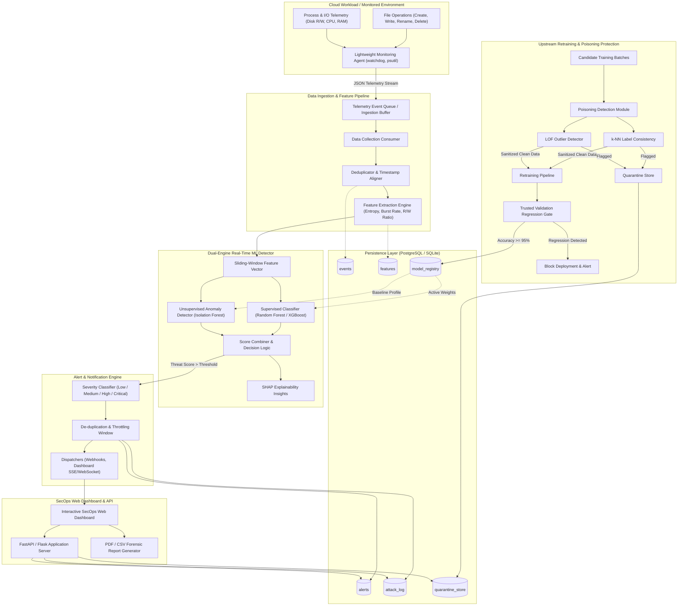
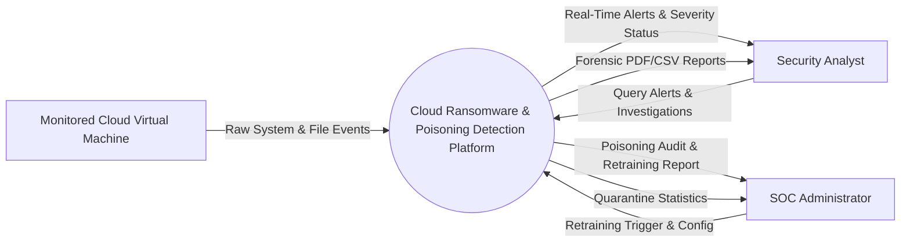
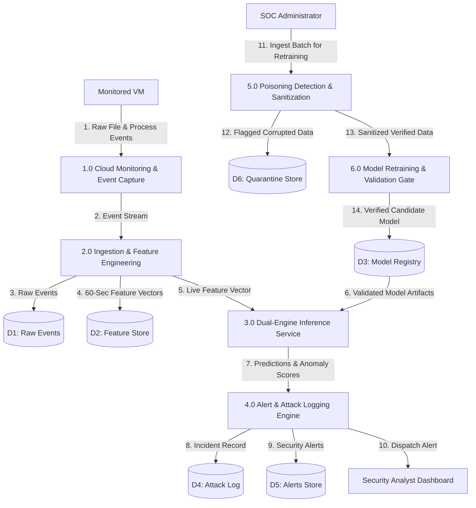
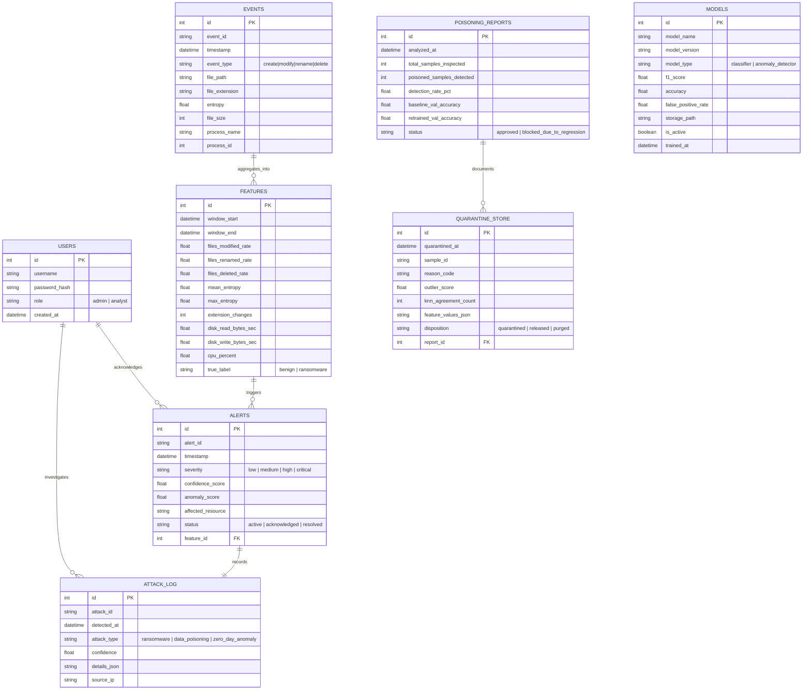
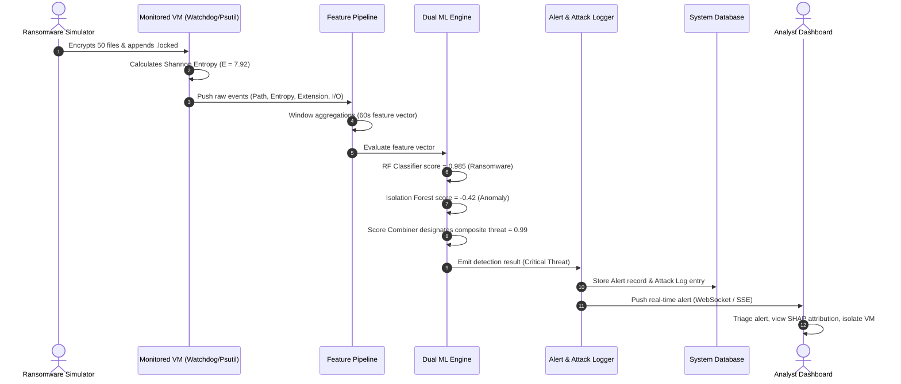
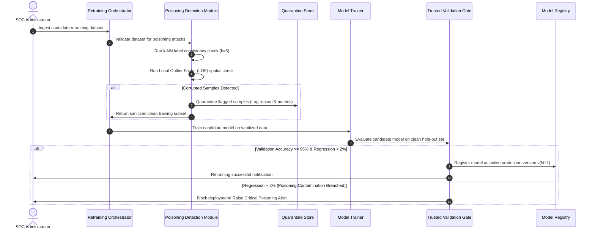

# System Architecture and Design Diagrams

This document contains formal design models for the **Real-Time Ransomware and Poisoning Attack Detection System**, including System Architecture, Data Flow Diagrams (Level 0 and Level 1), Entity Relationship Diagram, Use Case Diagram, and Sequence Diagrams.

---

## 1. High-Level System Architecture Diagram

---

## 2. Data Flow Diagrams (DFD)

### 2.1 Level-0 DFD (Context Diagram)

### 2.2 Level-1 DFD (Decomposed Subsystems)

---

## 3. Entity-Relationship (ER) Diagram

---

## 4. Sequence Diagrams

### 4.1 Sequence Diagram: Real-Time Ransomware Detection and Alerting

### 4.2 Sequence Diagram: Training Data Poisoning Defense & Retraining Gating

---

## 5. Use Case Diagram

```mermaid
flowchart LR
    subgraph Actors
        Admin((SOC Admin))
        Analyst((Security Analyst))
        SystemDaemon((Monitoring Agent))
    end

    subgraph SystemBoundary["Cloud Threat Detection Platform"]
        UC1([UC-1: Stream Host & Cloud Telemetry])
        UC2([UC-2: Detect Ransomware in Real-Time])
        UC3([UC-3: View Live Alerts & System Health])
        UC4([UC-4: Inspect SHAP Feature Importance])
        UC5([UC-5: Ingest Retraining Data])
        UC6([UC-6: Sanitize & Quarantine Poisoned Data])
        UC7([UC-7: Evaluate Model Validation Gate])
        UC8([UC-8: Export PDF/CSV Incident Reports])
        UC9([UC-9: Manage User Roles & Permissions])
    end

    SystemDaemon --> UC1
    UC1 --> UC2
    UC2 --> UC3
    Analyst --> UC3
    Analyst --> UC4
    Analyst --> UC8
    Admin --> UC5
    UC5 --> UC6
    UC6 --> UC7
    Admin --> UC9
```

