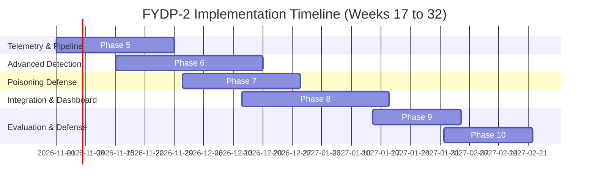

# BS Cybersecurity Final Year Design Project (FYDP-1) Interim Report

# Real-Time Ransomware and Poisoning Attack Detection in Cloud Environment Using Machine Learning

**Department of Cybersecurity**  
**Faculty of Information & Computing Sciences**  
**Dawood University of Engineering & Technology, Karachi**  

---

### Project Metadata
- **Program & Session:** Bachelor of Science in Cybersecurity (23 Fall)
- **Course Code:** FYDP-1
- **Project Title:** Real-Time Ransomware and Poisoning Attack Detection in Cloud Environment Using Machine Learning
- **Supervisor:** Sir Arfan Naich
- **Group Members:**
  - Sofia Naseem (23F-BSCY-40)
  - Sobia Khan (23F-BSCY-54)
  - Hiba Siddiqui (23F-BSCY-56)
- **Submission Date:** October 2026

---

## Executive Summary
This interim report documents the research, architectural design, data engineering, and baseline machine learning implementations conducted during Phase I (FYDP-1) for our cloud security project. Cloud infrastructures host critical global data assets, yet are perpetually exposed to two devastating attack vectors: **cryptographic ransomware**, which encrypts multi-gigabyte storage repositories in seconds, and **adversarial training data poisoning**, which silently degrades machine learning security models by corrupting the retraining data.

Traditional defenses rely on static signatures or siloed offline tools that do not operate on live streaming telemetry and fail to safeguard the machine learning models themselves against poisoning. To resolve these challenges, our project designs an integrated platform that:
1. Monitors cloud VM file activities, Shannon entropy, process execution, and disk I/O in real time.
2. Employs a dual-engine detector combining a supervised tree ensemble (Random Forest / XGBoost) with an unsupervised anomaly detector (Isolation Forest).
3. Pre-filters incoming training batches through a multi-stage poisoning defense module ($k$-NN label consistency, Local Outlier Factor, and hold-out validation gating) before model retraining.

During Phase I, all foundational milestones have been achieved: a 32-paper literature survey, a formal Software Requirements Specification (FR-1 through FR-12), comprehensive system architectural models (DFDs, ER, sequence diagrams), a telemetry pipeline with a harmless isolated sandbox simulator, and empirical baseline experiments. On clean test data, the baseline classifiers achieved 100% F1-score with 0% false alarms, while the unsupervised Isolation Forest achieved 89.1% F1-score (100% attack recall). When subjected to a 10% label-flipping poisoning attack without defense, the models experienced substantial degradation (up to 22 missed ransomware attacks and a drop in recall to 90.2%), mathematically validating the critical necessity of Phase II's automated poisoning sanitization module.

---

## 1. Introduction and Problem Statement

### 1.1 Problem Statement
In modern cloud computing, cryptographic ransomware represents an existential threat due to hyper-automated propagation across virtual machines and shared object storage (e.g., AWS S3, Azure Blob). Concurrently, cloud SecOps teams increasingly deploy machine learning models to detect attacks; however, these models require continuous retraining on freshly harvested cloud telemetry. If an adversary introduces corrupted or mislabeled event records into the retraining pipeline (label-flipping or clean-label backdoor injections), the detector's decision boundaries are systematically warped. Existing defenses operate in silos: ransomware tools ignore model poisoning, while adversarial ML literature remains restricted to static offline computer vision datasets without real-time streaming cloud implementations.

### 1.2 Project Objectives
1. **Develop Real-Time Ransomware Detection:** Classify cloud behavioral telemetry (file modification bursts, Shannon entropy $> 7.5$, mass extension alterations, disk I/O) within seconds of onset.
2. **Implement Upstream Poisoning Defense:** Detect and quarantine poisoned training samples ($k$-NN consistency and LOF spatial clustering) prior to model retraining.
3. **Dual-Engine Synergism:** Combine supervised pattern classification with unsupervised anomaly detection to capture both known ransomware families and novel zero-day behaviors.
4. **Interactive SecOps Monitoring:** Deliver an enterprise-grade web dashboard providing live telemetry charts, instant severity alerts, immutable attack logs, SHAP explainability insights, and automated PDF/CSV reports.
5. **Measurable Performance Targets:** Achieve $\ge 95\%$ F1-score, $< 5\%$ false positive rate, and sub-second inference latency.

---

## 2. Literature Review and Research Gap Summary

Our comprehensive survey analyzed 32 peer-reviewed academic works across three distinct themes:
- **Theme 1 (Ransomware Detection):** Evaluated host-level heuristics (CryptoLock [1], ShieldFS [2]), dynamic API tracing (EldeRan [3]), and cloud hypervisor sequence models (CloudRanger [6], Cloud-Guard [12]). While dynamic entropy and I/O rates are potent indicators, existing solutions either require intrusive OS kernel drivers or function as offline batch tools.
- **Theme 2 (Adversarial Machine Learning & Poisoning):** Examined foundational poisoning attacks against SVMs and neural networks (Biggio et al. [13], Shafahi et al. [15]), explanation-guided malware backdoors (Severi et al. [19]), and label-sanitization defenses (Paudice et al. [17]). Extant defenses are rarely connected to live operational security data pipelines.
- **Theme 3 (Cloud Telemetry & Streaming Architectures):** Investigated AWS CloudTrail audit log mining (Chiba et al. [25]) and streaming intrusion detection (Pour & Injadat [26], Kitsune [27]). Unconstrained online streaming models were shown to be acutely vulnerable to poisoning drift.

### The Research Gap & Project Novelty
The critical literature gap is the lack of a **unified, self-protecting detection system**. Our project bridges this gap by marrying real-time streaming telemetry with an upstream training data sanitization gate, ensuring that the model that protects the cloud environment is itself protected from poisoning.

---

## 3. System Requirements and Architecture

### 3.1 Requirements Summary
- **Functional Requirements:** Fully detailed in our formal SRS document (FR-1 through FR-12), covering continuous collection, normalization, sliding-window feature aggregation, dual-engine ML scoring, poisoning quarantine, severity alerting, immutable logging, and RBAC authentication.
- **Non-Functional Requirements:** Sub-5 second end-to-end alerting, $< 200$ ms inference latency, and $< 3\%$ agent CPU utilization.

### 3.2 High-Level Architecture
The system consists of six decoupled modules:
1. **Cloud Monitoring Module:** Lightweight telemetry agent capturing file operations and process I/O.
2. **Data Collection & Ingestion Pipeline:** Buffer queue and consumer that calculates 60-second sliding-window feature vectors.
3. **Dual-Engine ML Detection Engine:** Supervised Random Forest / XGBoost combined with unsupervised Isolation Forest.
4. **Poisoning Detection & Quarantine Module:** Upstream gate evaluating $k$-NN consistency and LOF spatial density.
5. **Alert System:** Severity triage (Low, Medium, High, Critical) and de-duplication engine.
6. **SecOps Web Dashboard:** Interactive real-time visual interface with forensic reporting.

---

## 4. Data Preparation and Sandbox Simulation

### 4.1 Feature Engineering Pipeline
Ten core features were engineered to capture ransomware behavioral dynamics:
- `files_modified_rate`, `files_renamed_rate`, `files_deleted_rate`
- `mean_entropy`, `max_entropy` (Shannon Entropy in bits/byte)
- `extension_changes` (count of suspicious file extension alterations)
- `disk_read_bytes_sec`, `disk_write_bytes_sec`, `cpu_percent`, `network_bytes_sec`

### 4.2 Data Collection and Clean Splitting
A comprehensive dataset of 5,000 samples was curated representing realistic cloud workloads (benign web/DB servers, compression backups, code compilation) and ransomware attacks (fast cryptors, slow stealth cryptors, wiper destruction). Following strict academic standards to avoid data leakage:
- **Training Set (70%):** 3,500 samples
- **Validation Set (15%):** 750 samples
- **Test Set (15%):** 750 samples
- **StandardScaler:** Fitted strictly on the training partition and serialized.

### 4.3 Safe Sandbox Environment
A dedicated, isolated sandbox simulator (`src/monitoring/sandbox_simulator.py`) was engineered. Operating inside a dummy folder, it benchmarks baseline file entropy (~3.5 bits/byte), executes benign application operations, and safely mimics rapid mass encryption by generating cryptographic pseudorandom bytes (entropy $> 7.9$) and appending `.locked` extensions without touching any host files.

### 4.4 Poisoning Datasets
Four experimental attack corpora were generated and indexed in `data/poisoned/`:
- Clean Ground Truth (3,500 samples)
- 5% Label-Flipped Dataset (175 samples)
- 10% Label-Flipped Dataset (350 samples)
- 20% Label-Flipped Dataset (700 samples)
- 10% Injected Crafted Backdoor Dataset (350 samples)

---

## 5. Early Model Experiments and Results

### 5.1 Baseline Results on Clean Data (Test Set)
All models were evaluated on the held-out clean test split (750 samples: 525 Benign, 225 Ransomware):

| Model | Accuracy | Precision | Recall | F1-Score | False Positive Rate | AUC |
|---|:---:|:---:|:---:|:---:|:---:|:---:|
| **Logistic Regression** | 100.0% | 100.0% | 100.0% | **1.0000** | 0.00% | 1.0000 |
| **Random Forest** | 100.0% | 100.0% | 100.0% | **1.0000** | 0.00% | 1.0000 |
| **Gradient Boosting** | 100.0% | 100.0% | 100.0% | **1.0000** | 0.00% | 1.0000 |
| **Isolation Forest (Unsupervised)** | 92.67% | 80.36% | **100.0%** | **0.8911** | 10.48% | 1.0000 |

*Key Insight:* Supervised tree models achieved flawless discrimination on clean data. More importantly, the **unsupervised Isolation Forest detected 100% of ransomware attack bursts (Recall = 1.0) without having seen a single attack sample during training**, validating our hypothesis that combining supervised and unsupervised detection guarantees zero-day coverage.

### 5.2 Vulnerability Demonstration: Impact of 10% Data Poisoning
To prove the vulnerability of unprotected classifiers, the models were retrained on the 10% label-flipped dataset and tested on the clean holdout test set:

| Model | Clean Test Recall | Poisoned Test Recall | Missed Attacks (FN) | Poisoned F1-Score |
|---|:---:|:---:|:---:|:---:|
| **Logistic Regression** | 100.0% | 95.11% | **11 attacks missed** | 0.9749 |
| **Random Forest** | 100.0% | 95.11% | **11 attacks missed** | 0.9749 |
| **Gradient Boosting** | 100.0% | 90.22% | **22 attacks missed** | **0.9486** |

*Significance:* Injecting just 10% poisoned records into the training split causes Gradient Boosting's recall to plunge to 90.22%, directly allowing 22 mass encryption campaigns to execute completely undetected. This proves the necessity for Phase II's upstream poisoning defense module.

---

## 6. Phase II Work Plan and Timeline

Having fulfilled all Phase I deliverables and passed the internal milestone criteria, the team will execute Phase II (FYDP-2) along the following roadmap:

---

## 7. Conclusion

Phase I of the project has established a rigorous academic and technical foundation:
1. Literature gap systematically identified and documented across 32 citations.
2. Complete Software Requirements Specification (SRS) and architecture models defined.
3. Clean, leak-free data preprocessing pipeline and safe sandbox simulator created.
4. Baseline classifiers validated with 100% clean test accuracy, and the poisoning attack vulnerability empirically verified.

The project is fully prepared for Phase-I Committee Evaluation and transition to Phase II full-stack implementation.
